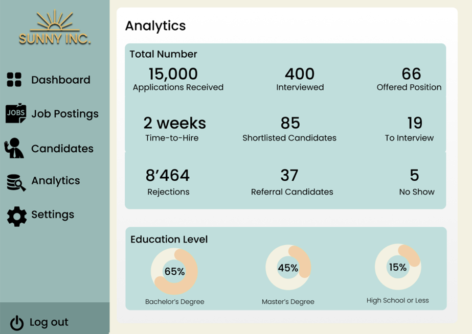
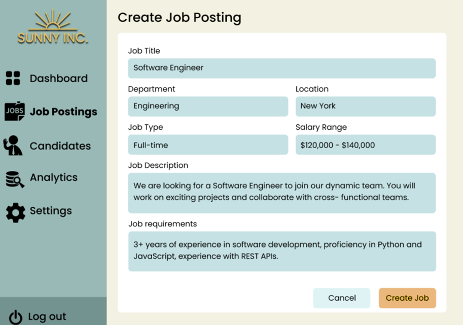
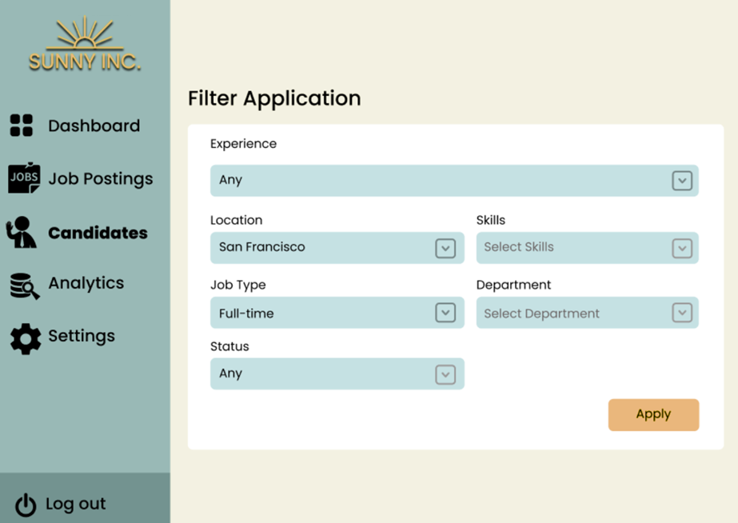
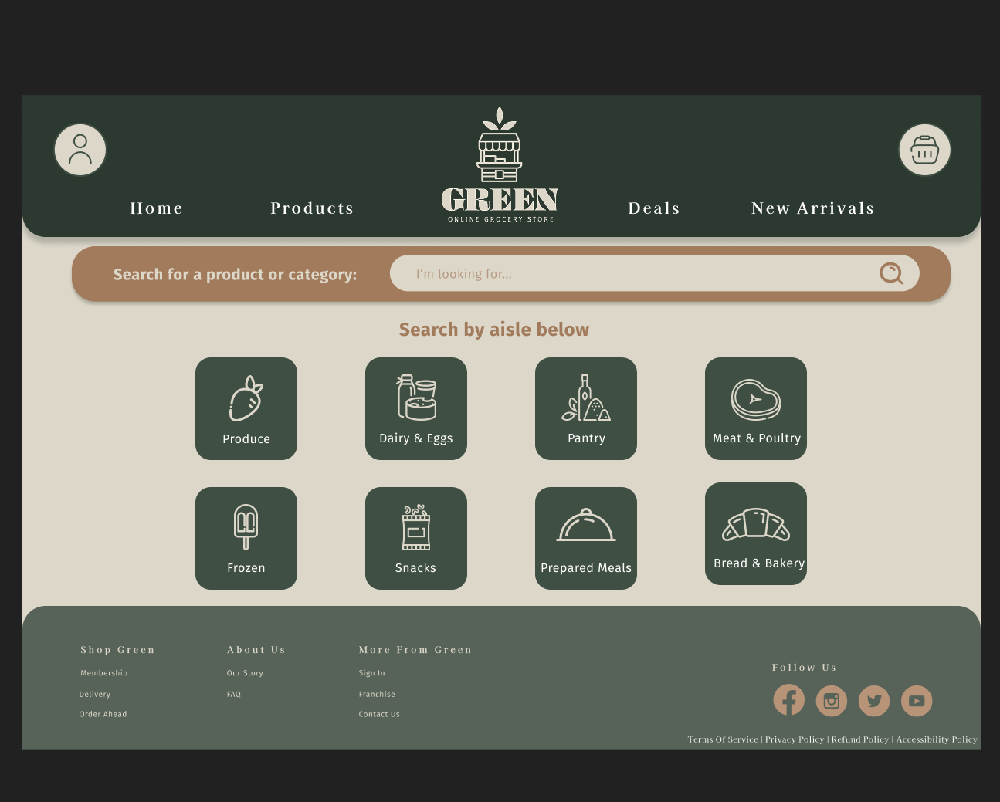
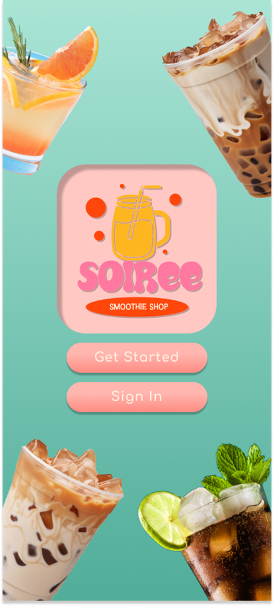
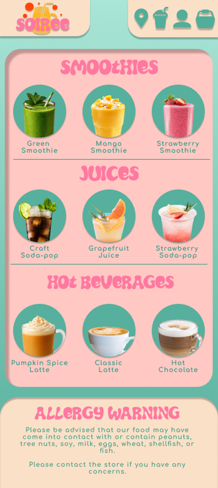
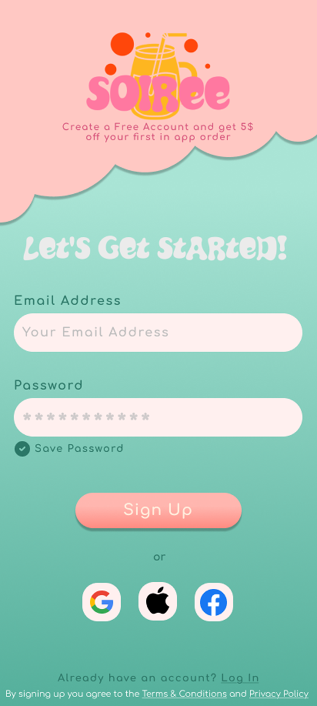

# Figma UI/UX Design Portfolio

A collection of UI/UX design work created in **Figma**, showcasing web page layouts, application interfaces, navigation flows, and user interaction concepts.

This portfolio highlights my approach to translating design ideas into visual interfaces and mapping user experiences through screen layouts and flow diagrams.

## Portfolio Contents

### 1. Web Page Design

A collection of website interface concepts exploring page layouts, content organization, and user-facing functionality.

<table>
  <tr>
    <td align="center">
      
       Applicant Statistics
    </td>
    <td align="center">
      
       Create Job Posting
    </td>
  </tr>
  <tr>
    <td align="center">
      
       Filter Job Postings
    </td>
    <td align="center">
      
       Grocery Home Page
    </td>
  </tr>
</table>

### 2 Figma UI/UX Design Portfolio

A collection of UI/UX design work created in **Figma**, showcasing web page layouts, application interfaces, navigation flows, and user interaction concepts.

This portfolio highlights my approach to translating design ideas into visual interfaces and mapping user experiences through screen layouts and flow diagrams.

## Portfolio Contents

### 1. Web Page Design

A collection of website interface concepts exploring page layouts, content organization, and user-facing functionality.

<table>
  <tr>
    <td align="center">
      
       Applicant Statistics
    </td>
    <td align="center">
      
       Create Job Posting
    </td>
  </tr>
  <tr>
    <td align="center">
      
       Filter Job Postings
    </td>
    <td align="center">
      
       Grocery Home Page
    </td>
  </tr>
</table>

### 2. Application Design

Application interface concepts demonstrating screen layouts and navigation across different parts of an application.

<table>
  <tr>
    <td align="center">
      
       Home Screen
    </td>
    <td align="center">
      
       Menu
    </td>
  </tr>
  <tr>
    <td align="center">
      
       Sign-Up Screen
    </td>
    <td></td>
  </tr>
</table>

### 3. Flow Diagrams

Flow diagrams illustrating user journeys, navigation paths, and interaction sequences.

**General Flow Diagrams**
- [Flow Diagram 1](<Flow Diagrams/Flow-Diagram-1.png>)
- [Flow Diagram 2](<Flow Diagrams/Flow-Diagram-2.png>)
- [Flow Diagram 3](<Flow Diagrams/Flow-Diagram-3.png>)

**Voice User Interface (VUI) Flow Diagrams**
- [VUI Flow Diagram 1](<Flow Diagrams/VUI-Flow-Diagram-1.png>)
- [VUI Flow Diagram 2](<Flow Diagrams/VUI-Flow-Diagram-2.png>)
- [VUI Flow Diagram 3](<Flow Diagrams/VUI-Flow-Diagram-3.png>)

**Additional Diagram Files**
- [Diagram Iteration 1](<Flow Diagrams/resize1.png>)
- [Diagram Iteration 2](<Flow Diagrams/resize2.png>)
- [Diagram Iteration 3](<Flow Diagrams/resize3.png>)

## Skills Demonstrated

- UI/UX Design
- Web Page Layout and Interface Design
- Application Interface Design
- Wireframing and Visual Design
- Interactive Prototyping in Figma
- User Flows and Navigation Mapping
- Voice User Interface (VUI) Flow Design

## Tools

- **Figma** – Interface design, visual layouts, and prototype interactions

## About This Portfolio

This repository contains exported visual examples of my Figma design work, organized by design type. The images provide a visual record of the interfaces and diagrams I created.

The original interactive Figma prototype is not included in this repository. The portfolio showcases the visual designs and concepts rather than functioning web or mobile applications.
